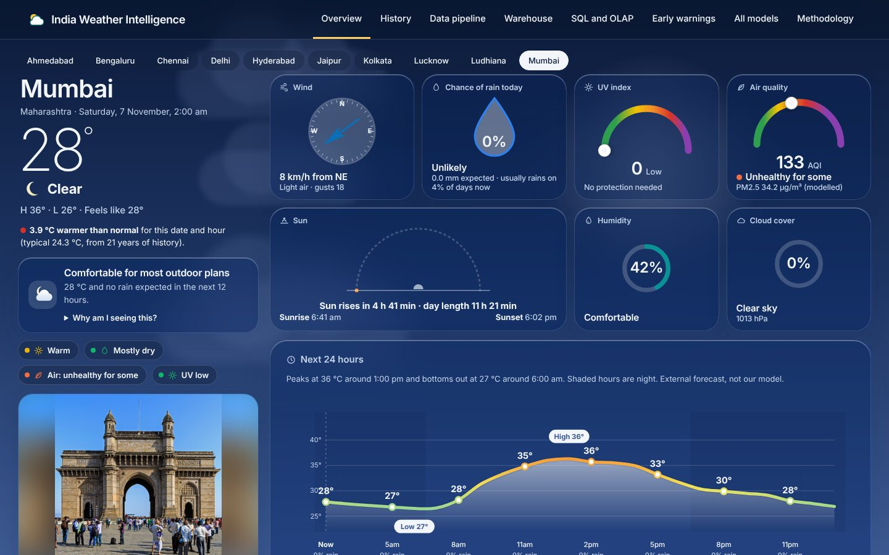
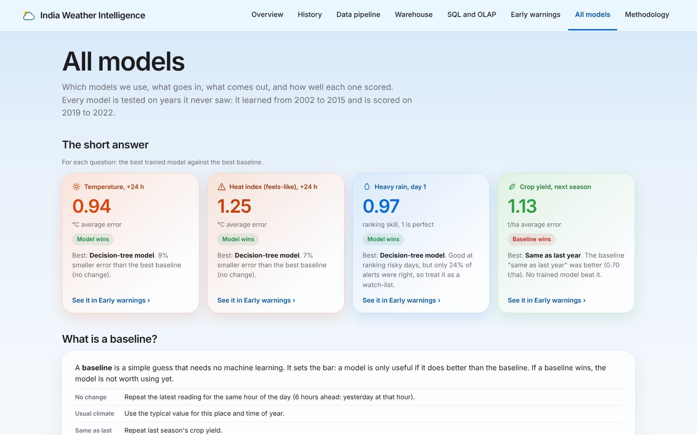
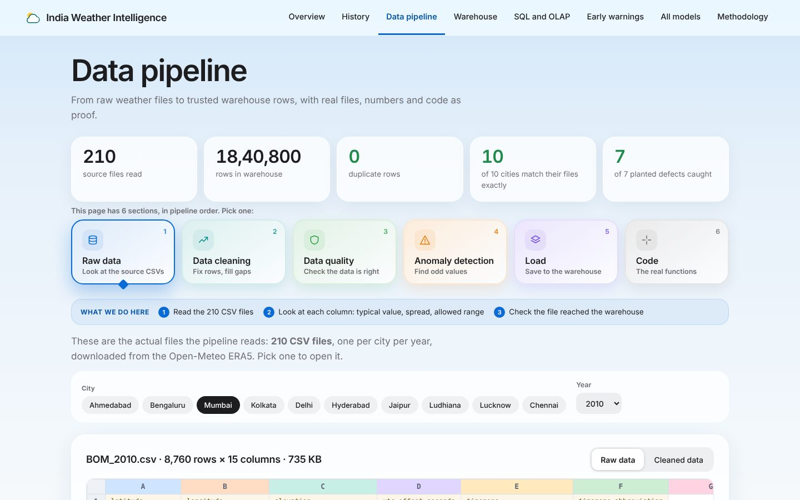

# India Weather Intelligence: A Weather Data Warehouse and Data Analysis Project

[](https://github.com/amaansiddiqueacademics-a11y/india-weather-intelligence/actions/workflows/ci.yml)
[](LICENSE)


A **data warehousing and data mining project** on 21 years of hourly weather for 10 Indian cities. It covers the full workflow: a validated ETL into a PostgreSQL star-schema warehouse, SQL/OLAP and exploratory analysis, forecast models for heat and heavy rain tested honestly against simple baselines, and a FastAPI backend feeding an interactive dashboard.



**Data:** ECMWF ERA5 hourly weather (2002-2022) via Open-Meteo, plus district crop statistics from the India Data Portal. 1,840,800 hourly rows and 2,529 crop rows after cleaning.

**Team:** Amaan Siddique ([@amaansiddiqueacademics-a11y](https://github.com/amaansiddiqueacademics-a11y)) and Abdul Hakim Shaikh ([@HakimK438](https://github.com/HakimK438)). Data Warehousing and Mining (DWM) mini project, TY Information Technology, Vidyalankar Institute of Technology, Mumbai; supervisor Dr. Vidya Chitre.

## Contents

[Results](#results) · [Quick start](#quick-start) · [Pipeline](#pipeline) · [Dashboard](#dashboard) · [API](#api) · [Tests](#tests) · [Layout](#layout) · [Limitations](#limitations) · [Credits and licences](#credits-and-licences)

## Results

All scores are on the test years 2019-2022, never used for training or tuning (train 2002-2015, validation 2016-2018; no random shuffling). Full tables: `reports/ml_report.json` and the dashboard's All models page.

| Risk | What is forecast | Best model | Best simple baseline | Gain |
|---|---|---|---|---|
| Urban heat | Temperature, next day (+24 h) | MAE 0.94 °C | 1.03 °C ("No change") | 9% |
| Urban heat | Temperature, +72 h | MAE 1.31 °C | 1.55 °C | 15% |
| Urban heat | Heat index, +6 / +24 / +72 h | MAE 1.14 / 1.25 / 1.72 °C | 1.35 / 1.35 / 2.03 °C | 15% / 7% / 15% |
| Heavy rain | At least 64.5 mm in 24 h, day 1 | PR-AUC 0.175 | 0.030 ("Usual climate") | about 6x |
| Heavy rain | Days 2 and 3 | PR-AUC 0.054 / 0.047 | 0.035 | little real skill |
| Agriculture | Seasonal crop yield, 4 districts | MAE 1.13 t/ha | 0.70 t/ha ("Same as last year") | baseline wins |

- Heat forecasts come with 90% ranges (rolling split-conformal) that cover 89.5-90.1% of test values.
- Heavy rain is rare (0.45% of test rows), so PR-AUC is the headline metric; ROC-AUC looks high even for the climatology baseline.
- The crop model losing to "same as last year" is reported as is: one city point cannot explain a district's yield, and irrigation, seeds and prices are not in the data.

## Quick start

### Option A: Docker (nothing else to install)

```
docker compose up -d --build                        # PostgreSQL + dashboard
docker compose run --rm app python -m wx.pipeline   # first time: download data, build the warehouse, train the models
```

Open <http://localhost:8077>. The first pipeline run takes 1-2 hours, almost all of it the rate-limited download; the raw files are kept in `data/` and reused afterwards. Before the pipeline has run, the API answers 503 with instructions instead of data.

### Option B: your own Python and PostgreSQL

Requires Python 3.12 or 3.13 and PostgreSQL 16+.

```
python -m venv .venv
.venv\Scripts\activate            # Windows (macOS/Linux: source .venv/bin/activate)
pip install -r requirements.txt
cd src
python -m wx.pipeline             # everything below, in order (resume with --from STEP)
python -m uvicorn wx.api:app --port 8077   # dashboard at http://localhost:8077
```

By default the project connects as user `postgres` without a password on `localhost:5432`, and creates the `wx` database itself. If your PostgreSQL has a password (the default on Windows), set the connection first:

```
$env:WX_DSN="host=localhost dbname=wx user=postgres password=YOUR_PASSWORD"          # Windows (PowerShell)
$env:WX_ADMIN_DSN="host=localhost dbname=postgres user=postgres password=YOUR_PASSWORD"
export WX_DSN="host=localhost dbname=wx user=postgres password=YOUR_PASSWORD"         # macOS/Linux
export WX_ADMIN_DSN="host=localhost dbname=postgres user=postgres password=YOUR_PASSWORD"
```

| Variable | Default | Purpose |
|---|---|---|
| `WX_DSN` | `host=localhost port=5432 dbname=wx user=postgres` | The warehouse database |
| `WX_ADMIN_DSN` | `host=localhost port=5432 dbname=postgres user=postgres` | Used once to create the `wx` database |
| `WX_START_YEAR`, `WX_END_YEAR` | `2002`, `2022` | Years to download |

`python -m wx.pipeline` runs these steps, which can also be run one by one:

```
python -m wx.download      # crop CSV + 210 weather CSVs into data/raw (rate-limited, resumable)
python -m wx.etl_weather   # validate, clean, transform, load (idempotent)
python -m wx.etl_agri
python -m wx.warehouse     # snowflake schema and materialised views
python -m wx.eda
python -m wx.ml            # heat and rain models, registry, evaluation
python -m wx.ml_agri
python -m wx.warehouse     # again, so the snowflake also gets the model predictions and metrics
```

The free Open-Meteo archive API has per-minute, hourly and daily quotas per IP address. The downloader waits and retries on the first two; if it reports "Daily API request limit exceeded", run it again after the quota resets (00:00 UTC, 05:30 IST). Files already saved are skipped.

## Pipeline

```
Open-Meteo ERA5 CSVs + India Data Portal crop CSV
  -> ETL (validate, clean, transform, load; idempotent; run logs and quarantine)
  -> PostgreSQL: star schema + snowflake schema + materialised views
  -> SQL / OLAP  ->  EDA  ->  ML models + evaluation + registry
  -> FastAPI (/api/*)  ->  static dashboard (web/)
```

**Cities:** Delhi, Mumbai, Kolkata, Chennai, Bengaluru, Hyderabad, Ahmedabad, Jaipur, Lucknow, Ludhiana (`config/locations.csv`).

| Risk | What it does | Notes |
|---|---|---|
| Urban heat | Temperature and heat index at +6 / +24 / +72 h with 90% rolling-conformal ranges | Weather-derived indicator, not health outcomes |
| Heavy rainfall | Probability of at least 64.5 mm in 24 h (IMD "heavy rain") at 24 / 48 / 72 h, isotonic-calibrated | Threshold chosen for >= 100 training events |
| Agriculture | Yield vs weather for Ahmedabad, Jaipur, Lucknow, Ludhiana | Loses to a last-year-yield baseline; reported as is |

Electricity demand, flood and health outcome data were not obtained. The Early warnings tab shows cooling degree-days as a clearly labelled weather indicator only.

## Dashboard

Pages follow a story order: Overview -> History -> Data pipeline -> Warehouse -> SQL and OLAP -> Early warnings -> All models -> Methodology.

| | |
|---|---|
|  |  |

Each model result has one home, so pages do not repeat each other:

| Page | What it shows about models |
|---|---|
| Overview | A past-day forecast test (split of years, step-by-step forecast, headline result, predicted-vs-actual proof) |
| Early warnings | Hazard context per risk (heat, rain, crops, power) and a try-a-day tool |
| All models | The single full scoreboard: every model, look-ahead and metric, plus what each model is |
| Methodology | The approach, rules, benefits and limits |

Models use the same names everywhere: **Decision-tree model**, **Linear model**, and the baselines **No change** and **Usual climate**.

Handy deep links:

- `#/overview?scene=clear&city=HYD` preview a scene for any city
- `#/history?city=BLR`
- `#/risk?tab=heat|rain|agri|power`

If a browser shows stale files after editing `web/`, bump the `?v=` stamp in `web/index.html`.

## API

All under `/api`; interactive docs at `/docs`.

| Area | Endpoints |
|---|---|
| Meta | `meta`, `health`, `overview`, `live`, `live/air`, `normal` |
| Pipeline extras | `etl/inventory`, `etl/source`, `etl/stress-test`, `etl/reconciliation`, `etl/flagged`, `etl/code` |
| History | `history`, `history/distribution`, `history/on-this-day`, `history/records`, `history/detail`, `history/year-vs-normal` |
| Risk and ML | `risk/hazards`, `risk/events`, `risk/crops`, `risk/signals`, `risk/cooling`, `models/crop`, `ml/summary`, `ml/breakdown`, `ml/predictions`, `ml/cases`, `ml/agri`, `POST predict`, `models/overview`, `POST models/explain` |
| Pipeline | `etl/runs`, `etl/run/{run_id}`, `eda` |
| Warehouse | `warehouse/schema`, `warehouse/preview`, `warehouse/profile`, `warehouse/trace`, `warehouse/compare`, `warehouse/comparisons` |
| OLAP and SQL | `olap/meta`, `olap/aggregate`, `olap/pivot`, `sql/questions`, `sql/run` |

`POST predict` takes `risk` = `heat` or `rain`; `ml/breakdown` also accepts `agri`. Unknown cities, measures or levels return 400/404 with the valid choices.

## Tests

```
pytest            # from the repository root: 59 tests
```

19 tests (ETL rules, the pipeline runner, API behaviour without a database) run anywhere, including CI. The other 40 check the API, SQL/OLAP and models against the loaded warehouse and are skipped until the pipeline has run. CI also lints the Python (`ruff.toml`), checks the dashboard scripts parse, confirms the saved models load with the pinned scikit-learn, and builds the Docker image.

## Layout

| Path | Contents |
|---|---|
| `sql/` | DDL: schemas, star, snowflake |
| `src/wx/` | download, ETL, warehouse, OLAP, EDA, features, ML, prediction, API, and `pipeline.py` (runs every step in order) |
| `web/` | Static SPA (vanilla JS + Plotly, no build step); one JS file per page. `web/data/` holds the India state outlines, `web/img/landmarks/` the offline fallback city photos |
| `tests/` | 59 tests (see [Tests](#tests)) |
| `models/` | Saved model artifacts (`.joblib`, scikit-learn 1.9.1) |
| `reports/` | `ml_report.json`, the test-set evaluation written by `wx.ml` |
| `config/` | `locations.csv`: the 10 cities, their grid points and crop districts |
| `docs/` | `DECISIONS.md` (sources, scope, trade-offs), `DATASET_FEASIBILITY.md`, screenshots |
| `Dockerfile`, `docker-compose.yml` | Option A above |
| `.github/workflows/ci.yml` | Continuous integration |

Raw data (`data/`) is not committed; `wx.download` recreates it from the public sources.

## Limitations

- ERA5 is gridded reanalysis, not station observation, so very local extremes are smoothed.
- scikit-learn Ridge/Logistic and HistGradientBoosting are used instead of LightGBM.
- No archived external forecasts, so comparison is against baselines, not a third-party forecast.
- Delhi, Mumbai, Kolkata, Chennai, Bengaluru and Hyderabad have no usable crop history, so agriculture covers four cities.

See `docs/DECISIONS.md` and the dashboard's Methodology page for details.

## Credits and licences

The code is released under the [MIT License](LICENSE). The data and media it uses keep their own licences:

- Weather: [Open-Meteo Historical Weather API](https://open-meteo.com/en/docs/historical-weather-api) (CC BY 4.0), based on ECMWF ERA5 / ERA5-Land reanalysis from the Copernicus Climate Change Service.
- Crops: [India Data Portal, Crop Wise Area Production Yield](https://indiadataportal.com/) (ODC-BY), from the Directorate of Economics and Statistics, Ministry of Agriculture.
- State outlines: [DataMeet India maps](https://github.com/datameet/maps) (CC BY 2.5 India), simplified.
- City photos: Wikipedia / Wikimedia Commons (loaded live; bundled thumbnails are used when Wikipedia is unreachable). Each photo links to its source page, which names the author and licence.
